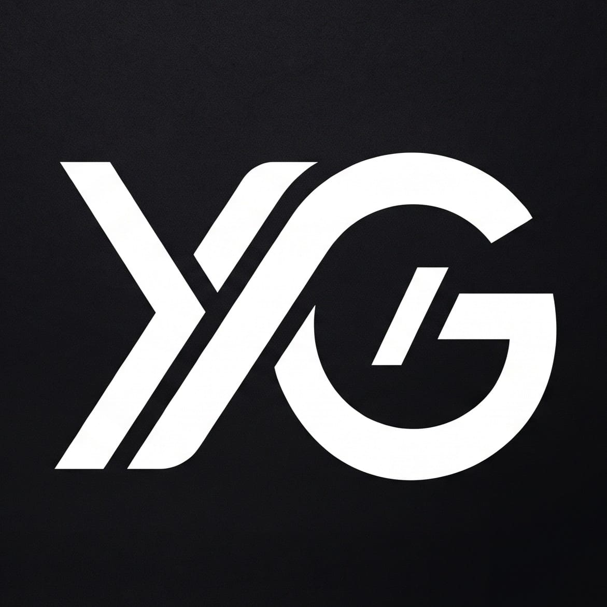

<div align="center">
  
  <h1>Yerson Garzón — Portafolio Profesional</h1>
  <p><strong>Desarrollador Full-Stack | React · Node.js · Express · PostgreSQL · MySQL</strong></p>
  <p>Neiva, Huila, Colombia</p>

  <p>
    <a href="https://yerson-rodriguez-portafolio-9nel.vercel.app/" target="_blank">
      
    </a>
    <a href="https://linkedin.com/in/YersonRodriguez" target="_blank">
      
    </a>
    <a href="https://github.com/YersonRodriguez2005" target="_blank">
      
    </a>
  </p>

  <!-- Badges de Tecnologías y Lighthouse -->
  <p>
    
    
    
    
    
    
    
  </p>
</div>

---

## 📌 Descripción del Proyecto

Aplicación web interactiva de portafolio personal diseñada desde cero con una arquitectura modular orientada a la conversión y experiencia de usuario (UX). Implementa estándares modernos de interfaz en modo oscuro (*deep dark mode* en `#09090b`), aceleración gráfica por hardware (GPU) para microinteracciones fluidas, optimizaciones de accesibilidad WCAG AA y renderizado condicional diferido para mantener altos puntajes en Google Lighthouse.

---

## ✨ Características Principales

* **Ambiente Cósmico Inmersivo:** Motor procedural de partículas estelares (`GlobalOrbs`) que genera un efecto de deriva y elevación continua sin bloquear el hilo principal.
* **Barra de Navegación Flotante (Glassmorphism):** Cabecera semitransparente con `backdrop-blur-md`, indicador de disponibilidad en tiempo real (*live pulse status*) y detección de scroll optimizada con `requestAnimationFrame`.
* **Tipografía Cinética Acelerada por GPU:** Ondas fluidas en títulos y nombres mediante animaciones compuestas (`transform` y `opacity`), eliminando repintados en CPU.
* **Bento Grid Informativo (Sobre Mí):** Tarjetas asimétricas que exponen la experiencia profesional real en producción (Petrol Services y CIA SAS), formación técnica y universitaria (SENA / Corporación Universitaria Iberoamericana) y nivel de inglés certificado por EF SET (B1).
* **Catálogo de Proyectos con Filtros por Solución:** Filtrado en tiempo real sin recargas para:
  * 🖥️ *Plataformas Web* (FieldOps Admin, Sistema POS Stop Food).
  * 🎓 *LMS / EdTech* (StudyTrack LMS, AcademicSync LMS).
  * 🛍️ *E-Commerce* (Lunaro E-Commerce).
  * 🌐 *Landing Pages* (VíaSegura).
  * 📱 *Móvil APK* (Modal de descarga directa de compilados Android).
* **Radar de Habilidades por Dominio Técnico:** Desglose honesto y contextualizado por responsabilidades de software (Frontend, Backend & REST APIs, Bases de Datos Relacionales, Herramientas & DevOps).
* **Gestor de Certificaciones con Filtros:** Listado de más de 14 certificaciones avaladas con métricas resumidas y control de paginación/expansión.
* **Footer de Conversión Directa:** Microinteracción de un solo clic para copiar el correo electrónico al portapapeles, enlaces directos a redes y botón de retorno al inicio.
* **Accesibilidad Integral:** Botón *Skip to main content* para navegación con teclado, soporte estricto de contrastes de color y compatibilidad con `prefers-reduced-motion`.

---

## 🚀 Métricas de Rendimiento (Google Lighthouse)

Auditoría ejecutada en entorno móvil de producción:

| Métrica | Puntuación | Estado |
| :--- | :---: | :---: |
| **Rendimiento (Performance)** | **96 / 100** | 🟢 Excelente |
| **Accesibilidad (Accessibility)** | **95+ / 100** | 🟢 Excelente |
| **Prácticas Recomendadas** | **100 / 100** | 🟢 Perfecto |
| **SEO** | **100 / 100** | 🟢 Perfecto |

* **First Contentful Paint (FCP):** 1.0 s
* **Speed Index (SI):** 1.4 s
* **Cumulative Layout Shift (CLS):** 0.00
* **Tamaño del bundle principal:** ~68.5 kB (gzipped)

---

## 🛠️ Stack Tecnológico

### Frontend & Core
* **React 18 / 19:** Biblioteca principal para renderizado declarativo y gestión de estado.
* **Tailwind CSS v4:** Motor de estilos utilitarios de última generación con importación nativa `@import "tailwindcss"`.
* **Lucide React:** Iconografía vectorial estilizada y accesible.
* **Vite v7:** Servidor de desarrollo ultrarrápido y empaquetador para producción.

### Optimización & Herramientas
* **Rollup Manual Chunks:** División de código (*code splitting*) separando `vendor-react` y `vendor-icons`.
* **Vercel Web Analytics & Speed Insights:** Monitoreo de tráfico en tiempo real y métricas Core Web Vitals.
* **SEO Técnico:** Integración de Open Graph, Twitter Cards, `sitemap.xml` dinámico y `robots.txt`.

---

## 📂 Estructura del Proyecto

```text
├── public/
│   ├── favicon.svg             # Favicon vectorial
│   ├── logo.png                # Marca personal minimalista
│   ├── Perfil.jpeg             # Fotografía de perfil / OG Image
│   ├── robots.txt              # Directivas para crawlers
│   ├── sitemap.xml             # Mapa del sitio para indexación
│   ├── google*.html            # Archivo de verificación Google Search Console
│   └── HV_Yerson_Garzon_...pdf # Currículum Vitae descargable
├── src/
│   ├── components/
│   │   ├── Header.jsx          # Barra de navegación flotante y responsive
│   │   ├── Presentation.jsx    # Hero section con typewriter y CTAs
│   │   ├── About.jsx           # Bento Grid de trayectoria y formación
│   │   ├── Projects.jsx        # Catálogo de proyectos con filtros y modal APK
│   │   ├── Skills.jsx          # Competencias técnicas por dominio
│   │   ├── Certificates.jsx    # Certificaciones con filtros y estadísticas
│   │   └── Footer.jsx          # Contacto directo, redes y créditos
│   ├── App.jsx                 # Ensamblador principal y motor de partículas
│   ├── index.css               # Capa base de Tailwind v4 y keyframes GPU
│   └── main.jsx                # Punto de entrada de React
├── index.html                  # Metadatos SEO, Open Graph y viewport
├── vite.config.js              # Configuración de Vite, alias y chunks
└── package.json                # Dependencias y scripts
```

---

## 💻 Instalación y Ejecución Local

Sigue estos pasos para clonar y ejecutar el portafolio en tu entorno de desarrollo:

1. **Clonar el repositorio:**
   ```bash
   git clone https://github.com/YersonRodriguez2005/Mi-Portafolio.git
   cd Mi-Portafolio
   ```

2. **Instalar dependencias:**
   ```bash
   npm install
   ```

3. **Iniciar el servidor de desarrollo:**
   ```bash
   npm run dev
   ```
   Abre [http://localhost:3000](http://localhost:3000) en tu navegador para ver la aplicación.

4. **Compilar para producción:**
   ```bash
   npm run build
   ```
   Los archivos optimizados se generarán en la carpeta `dist/`.

5. **Previsualizar la compilación localmente:**
   ```bash
   npm run preview
   ```

---

## 🌐 Despliegue en Producción

El proyecto está configurado para despliegue continuo (CI/CD) a través de **Vercel**:

* **Rama de producción:** `main`
* **Comando de compilación:** `vite build`
* **Directorio de salida:** `dist`
* **Ruta de verificación de Google:** Verificada vía Search Console con archivo HTML estático en `/public`.

---

## 👤 Autor

**Yerson Fabián Garzón Rodríguez**
* **Rol:** Desarrollador Full-Stack Junior
* **Ubicación:** Neiva, Huila, Colombia
* **Correo:** [rodriguezyerson2005@gmail.com](mailto:rodriguezyerson2005@gmail.com)
* **Teléfono:** +57 321 639 3715
* **LinkedIn:** [linkedin.com/in/YersonRodriguez](https://linkedin.com/in/YersonRodriguez)
* **GitHub:** [github.com/YersonRodriguez2005](https://github.com/YersonRodriguez2005)

---

## 📄 Licencia

Este proyecto está bajo la Licencia **MIT**. Consulta el archivo `LICENSE` para más información.